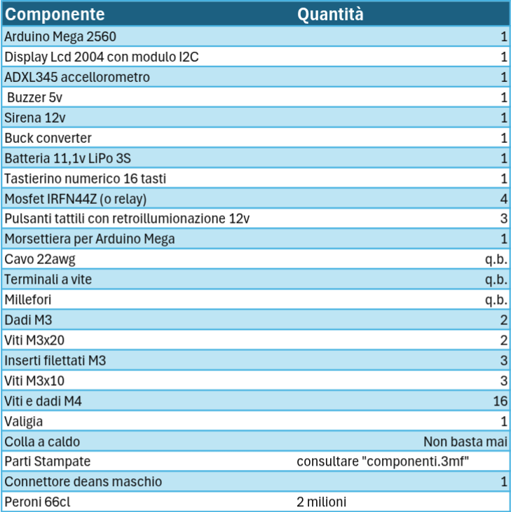
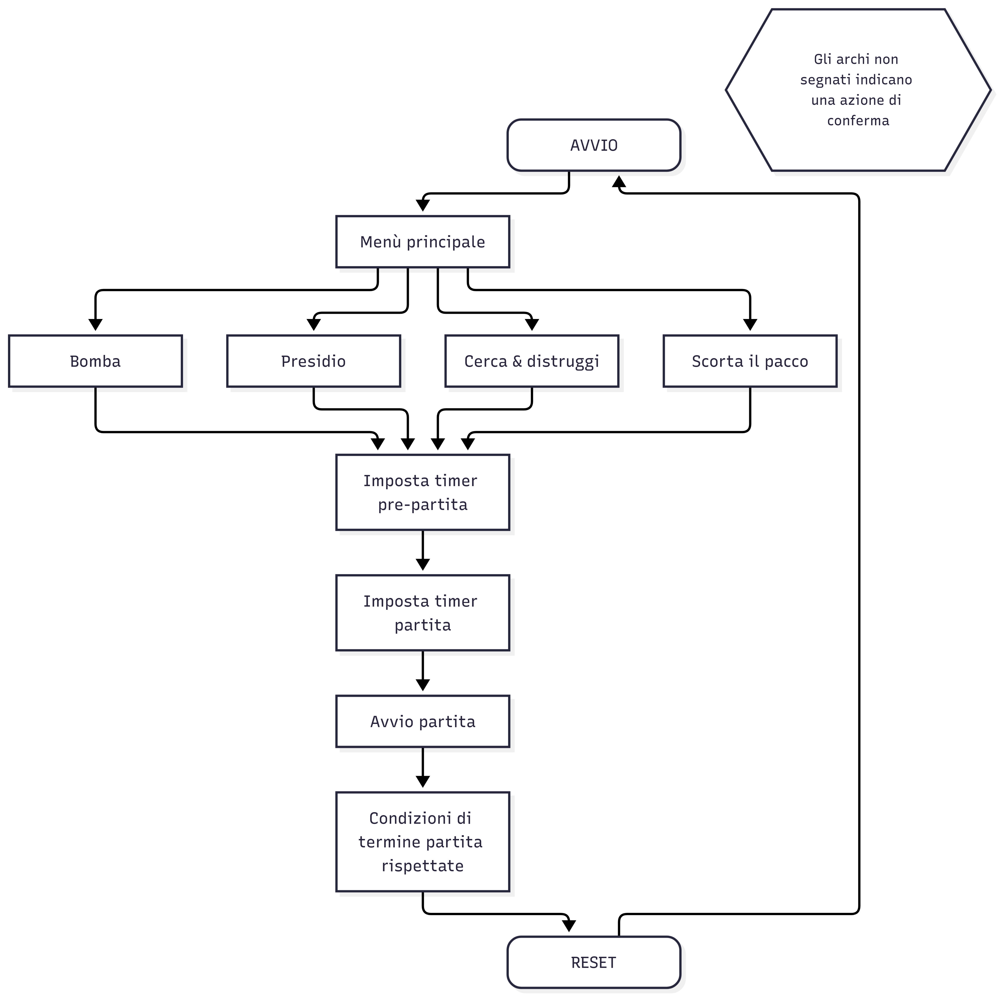

Autori: Giuseppe Difilippo e Andrea Benassi
****
## Descrizione 
Si tratta di una **replica** di ordigno creato per le giocate a softair.
****
## Modalità:
N.B. ogni partita finisce con la vittoria di uno schieramento
- **bomba**: la squadra di attacco deve disinnescare la bomba, mentre la squadra di difesa deve impedirne il disinnesco.
  La squadra in difesa vince allo scadere del timer.
  La squadra in attacco vince tramite il disinnesco della bomba. Il disinnesco avviene tramite la pressione prolungata del pulsante per un tempo di 20 secondi.
- **cerca e distruggi**: la squadra di attacco deve portare la bomba presso uno dei due siti predisposti e innescarla. 
  La squadra di attacco vince se, dopo averla innescata, la bomba detona.
  La squadra  di difesa vince se la squadra di attacco fallisce nel piazzare la bomba o se viene innescata e successivamente disinnescata.
- **presidio**: tre squadre competono per mantenere il controllo dell'obiettivo per più tempo. 
  Il controllo viene acquisito premendo il pulsante corrispondente alla propria squadra.
  Allo scadere del timer vincerà la squadra che ha accumulato più secondi al controllo dell'obiettivo.
- **countdown**: semplice timer 
- **nitro**: la squadra di attacco deve trasportare la valigia all'obiettivo a passo lento per evitarne la detonazione.
  La squadra di attacco vince se riesce a portare la bomba all'obiettivo senza farla esplodere prima dello scadere del tempo.
  La squadra in difesa vince se riesce a impedire l'arrivo della valigia all'obiettivo fino allo scadere del tempo.
****
## BOM

****
## Diagramma di flusso

## Schematica
img src="BOM.png" width="550" align="center">
